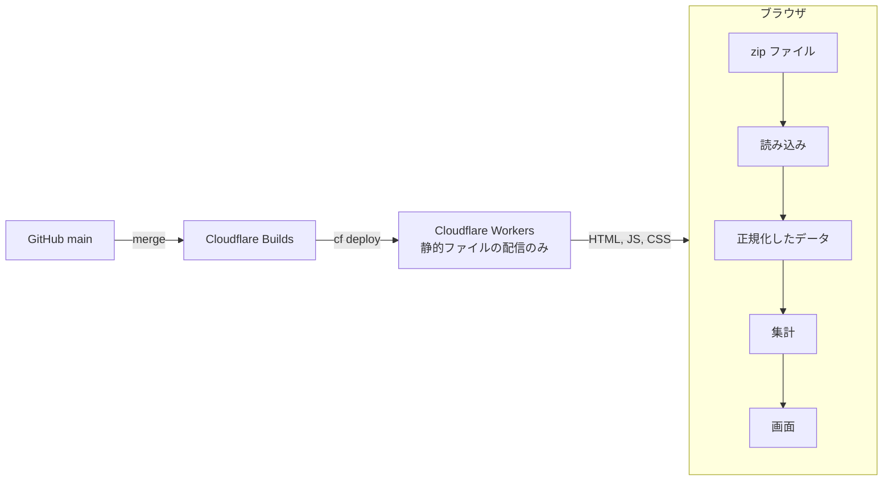
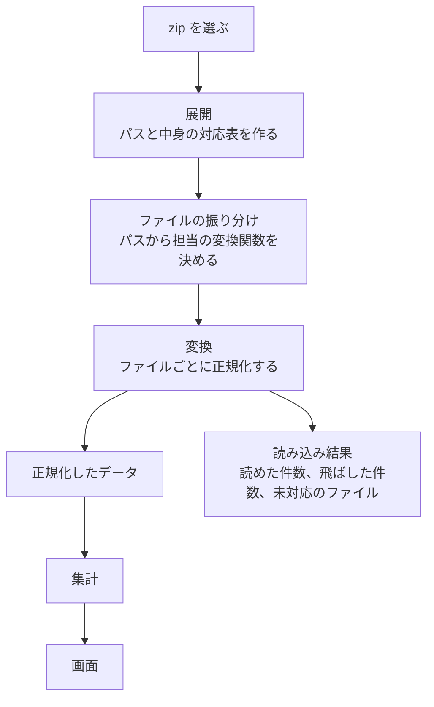
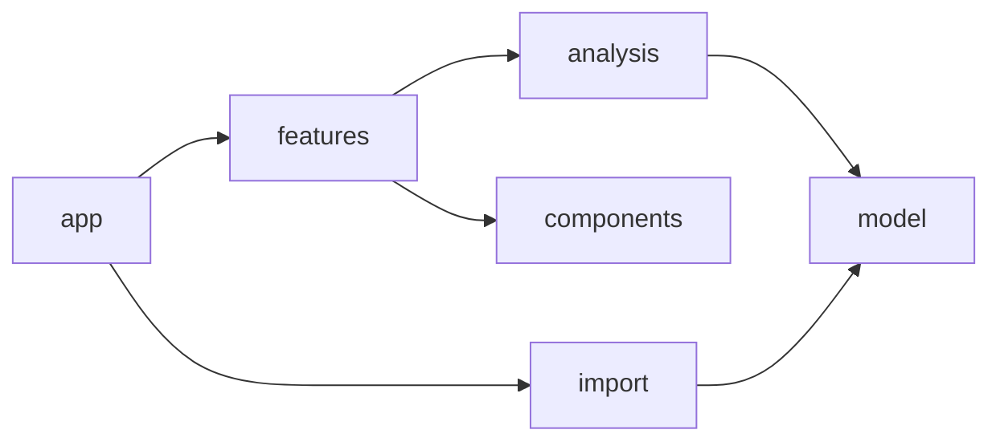

# riot-data-dashboard 設計

`docs/original.md` の要求を実現するための設計をまとめる。
入力データの構造は `docs/data-structure.md` を前提とする。

## 1. 目的と範囲

### 作るもの

Riot Games のデータ開示で受け取った zip を読み込み、自分のアカウントの記録を振り返るダッシュボードである。
答える問いは次の 4 つ。

- いつ、どのゲームを、どれだけ遊んだか
- どのくらい勝ったか、ランクはどう動いたか
- いくら使い、何を買ったか
- アカウントに何が起きたか（変更、ペナルティ、問い合わせ）

### 作らないもの

- サーバーへのデータ保存、ユーザー登録、ログイン
- Riot API からのデータ取得
- 試合内容の分析（開示データに含まれないため。LoL と TFT は試合履歴そのものが無い）
- 他人とのデータ共有、公開ページの生成
- 通貨の換算（円と米ドルは別々に集計する）
- IP アドレスからの地域推定

## 2. 設計方針

| 方針 | 内容 |
|---|---|
| データはブラウザから出さない | zip の展開、解析、集計をすべてブラウザ内で行う。サーバーには送らない |
| サーバー側の処理を持たない | Cloudflare Workers は静的ファイルの配信だけを行う |
| 欠けと未知に強くする | ファイルが無い、空である、知らないファイルがある、という状況でも止まらない |
| 生データと表示を切り離す | zip の表記ゆれは読み込み時に吸収し、画面側は正規化した形だけを見る |
| 出せないものは出せないと示す | 試合履歴が無いゲームでは、その旨を画面に明記する |

### データをブラウザから出さない理由

- zip には IP アドレス、メールアドレス、生年月日、チャット本文、問い合わせ本文が入っている。
- zip は展開しても約 7MB で、ブラウザだけで十分に処理できる。
- サーバーに保存しなければ、認証、保管、削除、漏えい対策がすべて不要になる。

`docs/original.md` の「アップロード」は、「利用者が zip をアプリケーションに渡す操作」と解釈する。
ファイルはブラウザに読み込まれるだけで、ネットワークには流れない。

## 3. 全体構成



- Workers はスクリプトを持たず、静的アセットだけを配信する。
- ブラウザは最初に HTML、JS、CSS を取得する。それ以降の通信は発生しない。
- 利用者のデータが通る経路は、ブラウザの中だけである。

## 4. 技術スタック

| 用途 | 採用 | 理由 |
|---|---|---|
| 言語 | TypeScript | 表記ゆれの多いデータを型で整理するため |
| ビルド | Vite + `@cloudflare/vite-plugin` | `cf init` が生成する標準の構成である |
| 設定 | `cloudflare.config.ts` | `cf` コマンドが読む設定ファイル。`wrangler.toml` は使わない |
| UI | React | 画面数と図表の数が多く、部品化の利点が大きい |
| ルーティング | wouter | 画面の切り替えだけに使う。小さく、依存が少ない |
| スタイル | CSS Modules + CSS カスタムプロパティ | UI ライブラリに頼らず、見た目を細かく制御するため |
| 図表 | Observable Plot | 時系列、積み上げ棒、ヒートマップを少ないコードで描ける |
| zip の展開 | fflate | 小さく高速で、ブラウザで動く |
| テスト | Vitest | Vite と設定を共有できる |
| 整形と静的検査 | Biome | 1 つの道具で両方を担える |
| パッケージ管理 | pnpm | |

スキーマ検証のライブラリは使わない。
どの項目も日時や列挙値の変換が必要になるので、ファイルごとの変換関数を手で書くほうが単純である。

### 動作確認済みの事項

2026-11-22 に手元で確認した。

- `cf init` は `cloudflare.config.ts`、`vite.config.ts`、`package.json`、`tsconfig.json` を生成する。
- `cloudflare.config.ts` でエントリポイントを省き、`assets` だけを指定した構成で `cf build` が成功する。
- 同じ構成で `cf deploy --dry-run` が成功する（アップロードは行っていない）。
- ビルド結果は `.cloudflare/output/v1/` に出力される。

確認に使ったバージョンは、cf 1.0.0-rc.2、Vite 8.3.8、`@cloudflare/vite-plugin` 2.0.0-rc.3、TypeScript 7.0.2 である。
`cf` と Vite プラグインは正式版の前なので、設定の書式が変わる可能性がある。

## 5. データの流れ



### 5.1 展開

- zip をメモリ上で展開し、「パス → 中身」の対応表を作る。
- パスは小文字にそろえて扱う。`2XKO/` と `2xko/` が別フォルダとして入っているためである。
- `readme.csv` は読み飛ばす。
- 既知のフォルダが 1 つも無い zip は、Riot の開示データではないと判断してエラーを表示する。
- 展開後の合計サイズとエントリ数に上限を設け、超えた場合は中止する。

### 5.2 ファイルの振り分け

パスのパターンと変換関数の対応表を 1 か所に持つ。

| パターン | 変換先 |
|---|---|
| `riotaccount/account_info.json`、`leagueoflegends/summoner.json`、`leagueoflegends/clash.json` | アカウント情報 |
| `riotaccount/account_audit_events_v1_uc.json`、`..._v2_uc.json` | アカウントの出来事 |
| `riotaccount/atlas_login_event_uc.json` | ログイン記録 |
| `leagueoflegends/store_transactions_uc.json` | 取引 |
| `leagueoflegends/rp_purchase_history_uc.json` | 支払い |
| `leagueoflegends/chat_logs_v2_uc/successes/*.json` | チャットログ |
| `valorant/valorant_match_history_uc.json` | 試合 |
| `valorant/valorant_payment_event_uc.json` | 支払い |
| `valorant/valorant_purchase_event_uc.json` | 取引 |
| `legendsofruneterra/lor_*.json` | 試合、支払い、取引 |
| `wildrift/wildrift_*.json` | 試合、取引、所持品、残高 |
| `teamfighttactics/tft_chat_logs_v2_uc/successes/*.json` | チャットログ |
| `*/*grouped_reports.json` | 通報件数 |
| `penalties/penalty_history.json` | ペナルティ |
| `zendesk/zendesk_tickets.json` | 問い合わせ |

- 対応表に無いファイルは「未対応のファイル」として読み込み結果に載せる。
- 中身が空配列のファイルは「データなし」として扱う。
- サンプルで空だったファイル（2XKO など）は項目が分からないので、初版では「未対応」とする。

### 5.3 変換

変換関数は 1 ファイルを受け取り、正規化したレコードの配列を返す。

- **1 件の失敗で全体を止めない。** 読めないレコードは飛ばし、件数を読み込み結果に記録する。
- **1 ファイルの失敗で全体を止めない。** 変換関数が例外を出しても、ほかのファイルの読み込みは続ける。
- **知らない項目は無視する。** 知らない列挙値は「その他」に寄せ、元の値を保持する。

変換時にそろえる内容は次のとおり。

| 対象 | そろえ方 |
|---|---|
| 日時 | 9 種類の書式を、UTC のエポックミリ秒（数値）に統一する |
| 日付だけの値 | その日の 0 時（UTC）として扱い、「日付のみ」の印を付ける |
| タイムゾーンの記載が無い日時 | UTC とみなす（未確認の前提。`docs/data-structure.md` を参照） |
| 値なし | null、`Unknown`、`Not Applicable`、空文字列を null に統一する |
| 文字列の数値 | 数値に変換する |
| 金額 | 金額を 100 倍した整数に統一する（`real_currency_paid_x100` と同じ単位。1,000 円は 100000 になる） |
| 文字列 | 前後の空白と改行を取り除く |
| 勝敗 | `win` / `loss` / `none` に統一する |
| Wild Rift のスキン | 入れ替わっている `champion_name` と `skin_name` を正しい向きに戻す |

### 5.4 実行する場所

初版では、展開と変換をメインスレッドで実行する。
サンプルの規模（約 7MB、最大のファイルで約 3 万件）では、体感できる待ち時間にならない見込みである。

読み込みと集計のコードは、React と DOM に依存させない。
大きな zip で画面が固まる場合に、Web Worker へそのまま移せるようにするためである。

## 6. 正規化したデータの形

画面と集計は、この形だけを扱う。

| 種類 | 主な項目 | 元データ |
|---|---|---|
| アカウント情報 | Riot ID、ユーザー名、メールアドレス、生年月日、LoL のプラットフォーム | `account_info.json`、`summoner.json`、`clash.json` |
| ログイン記録 | 日時、対象（ゲームの区分）、種類、IP アドレス | `atlas_login_event_uc.json` |
| 試合 | ゲーム、ID、開始と終了、長さ、種別、勝敗、勝率に数えるか、ゲーム固有の情報 | VALORANT、LoR、Wild Rift の試合履歴 |
| 支払い | ゲーム、日時、通貨、金額、決済手段、付与されたゲーム内通貨 | LoL、VALORANT、LoR の課金履歴 |
| 取引 | ゲーム、日時、種類、品目、通貨ごとの増減、取引後の残高 | LoL のストア取引、各ゲームの購入履歴 |
| 所持品 | 分類、名前、数 | Wild Rift |
| アカウントの出来事 | 日時、種類、補足 | アカウント変更履歴 v1 / v2 |
| ペナルティ | 日時、対象、種類、理由、状態 | `penalty_history.json` |
| 通報件数 | ゲーム、向き（した / された）、分類、件数 | 各ゲームの `grouped_reports.json` |
| チャットログ | ゲーム、試合 ID、試合日、場面、発言 | LoL、TFT |
| 問い合わせ | ID、件名、状態、作成日時、やりとり | `zendesk_tickets.json` |
| 読み込み結果 | ファイルごとの状態、件数、飛ばした件数、警告 | 読み込み処理が生成する |

### 試合

ゲームごとに項目が違うので、共通部分とゲーム固有部分に分ける。

| 区分 | 項目 |
|---|---|
| 共通 | ゲーム、ID、開始日時、終了日時、長さ（秒）、種別、勝敗、勝率に数えるか |
| LoR 固有 | デッキ ID、地域、ターン数、決着の理由、端末 |
| Wild Rift 固有 | その時点のランク、アカウントレベル |

種別は、表示用に次の区分へ寄せる。元の値も保持する。

| 区分 | 例 |
|---|---|
| ランク | VALORANT の `Ranked`、LoR の `Ranked`、Wild Rift の `Ranked` |
| 通常 | `Unrated`、`Swiftplay`、`Normal` |
| その他の対戦 | `Spike Rush`、`Deathmatch`、内部コード名のモード |
| カスタム | `Custom Game`、`Tournament` |
| 練習 | `ShootingRange`、チュートリアル、対 AI 戦 |

「勝率に数えるか」は次の規則で決める。

- 練習に区分した試合は数えない。
- VALORANT の `Deathmatch` は数えない（勝敗がほぼすべて `Loss` で記録されているため）。
- Wild Rift の `Noncompetitive` は数えない。

### 取引

LoL のストア取引は、RP の購入、贈り物、返金なども 1 つのファイルに混ざっている。
これらを次の種類に分類する。

| 種類 | LoL の `type` |
|---|---|
| 購入 | `PURCHASE`、`PURCHASE_BUNDLE_ITEM`、`PURCHASE_NON_REFUNDABLE`、`MYSTERY_PURCHASE` |
| 通貨の購入 | `USER_PURCHASED_RP`、`USER_PURCHASED_RP_GIFT` |
| 贈った | `PURCHASED_GIFT`、`PURCHASED_MYSTERY_GIFT`、`ITEM_TRANSFER_SENT`、`RP_TRANSFER_SENT` |
| 受け取った | `ITEM_TRANSFER_RECEIVED`、`RP_TRANSFER_RECEIVED` |
| 返金 | `REFUND` |
| 報酬 | `PERK`、`MYSTERY_PERK`、`PROMO_REDEMPTION`、`COMMUNITY_REDEMPTION`、`LEAGUES_REWARD`、`RAF_REWARD` |

- 分類は、`type` の名前と通貨の増減の向きから推定したものである。
- 贈り物は、購入の行と品目を移す行の 2 行で記録されていると見られる（サンプルでは両者の件数が一致した）。件数を数えるときは一方だけを使う。
- 通貨の増減は「通貨名と符号付きの量」の組で持つ。LoL では RP とブルーエッセンスの 2 つである。
- `ip_delta` と `ip_balance` は、ブルーエッセンスとして読み替える。
- LoL の「通貨の購入」は、支払いの記録と ID で結び付ける。

### ログイン記録の対象

`product` をゲームの区分に寄せる。

| 区分 | `product` |
|---|---|
| LoL / TFT（PC） | `League/TFT PC`、`lol` |
| TFT（モバイルほか） | `TFTm`、`TFT` |
| VALORANT | `VALORANT` |
| Wild Rift | `Wild Rift` |
| LoR | `Legends of Runeterra` |
| Riot アカウント共通 | `riot_client`、`rso-prod`、`rso-authenticator-prod`、null |

- PC 版の LoL と TFT は `product` が同じなので、分けられない。
- 「Riot アカウント共通」は、ゲームごとの活動量には数えない。

## 7. 集計

集計は、正規化したデータを受け取って図表用の値を返す純粋な関数として書く。

| 指標 | 求め方 |
|---|---|
| 活動した日 | ログイン記録または試合がある日。ゲームの区分ごとに数える |
| 時間帯の分布 | ログイン記録と試合の開始時刻を、曜日と時刻で数える |
| プレイ時間 | 試合の長さの合計。試合履歴があるゲームだけ |
| 勝率 | 勝率に数える試合の、勝ち ÷（勝ち + 負け） |
| ランクの推移 | Wild Rift の試合ごとのランクを時系列に並べる |
| 課金額 | 支払いの合計。通貨ごとに別々に集計する |
| 残高の推移 | 取引後の残高を時系列に並べる |
| 最古の記録 | 全種類のデータのうち、もっとも古い日時 |

- **日時の表示と集計は、ブラウザのタイムゾーンで行う。** データは UTC なので、時間帯の分布は変換してから数える。
- **LoL と TFT にはプレイ時間も勝率も無い。** ログイン記録から求めた活動日数だけを示す。
- 期間の絞り込み（全期間、または年）を全画面で共通に持つ。

## 8. 画面

### 画面の一覧

| 画面 | 内容 | 主な図表 |
|---|---|---|
| 読み込み | zip を選ぶ。データが外に送られないことの説明 | なし |
| 概要 | アカウント全体の要約 | 主要な数値、ゲーム別の活動量の推移、日ごとの活動カレンダー |
| 活動 | いつ遊んだか | 活動カレンダー、曜日と時刻のヒートマップ、ゲーム別の推移 |
| VALORANT | 試合と購入 | 期間別の試合数、種別ごとの勝率、プレイ時間、購入の一覧 |
| League of Legends | ストアの履歴 | RP とブルーエッセンスの残高推移、分類別の購入数、贈り物の一覧 |
| Legends of Runeterra | 試合と購入 | 勝率、地域の組み合わせ、ターン数の分布、決着の理由 |
| Wild Rift | 試合と所持品 | 勝率、ランクの推移、所持品の一覧 |
| 課金 | 現金での支払い | 通貨別の合計、年別とゲーム別の内訳、累計の推移、一覧 |
| アカウント | アカウントの記録 | 変更履歴の年表、ペナルティ、通報件数、問い合わせ、チャットログ、IP アドレスの一覧 |
| 読み込み結果 | 何を読めたか | ファイルごとの件数、飛ばした件数、未対応のファイル |

- ゲームの画面は、そのゲームのデータがあるときだけメニューに出す。
- TFT は試合履歴が無いので、専用の画面を作らない。活動量は「活動」に載せる。
- チャットログは、LoL と TFT のどちらも「アカウント」に載せる。
- データを読み込む前は、どのパスを開いても「読み込み」を表示する。

### 画面の構成

- 左にメニュー、右に内容を置く。幅が狭い画面では、メニューを上部にたたむ。
- 各画面の先頭に主要な数値を並べ、その下に図表、最後に一覧を置く。
- 図表には、同じ内容を表で確認できる切り替えを付ける。
- 件数が多い一覧（ログイン記録、取引）は、ページ分割して表示する。

### 出せないものの示し方

データが無い理由を、画面上で区別して示す。

| 状況 | 表示 |
|---|---|
| 開示データにその情報が含まれない | 「Riot の開示データには含まれません」 |
| ファイルはあるが中身が空 | 「記録がありません」 |
| ファイルがあるが未対応 | 「このファイルの表示には未対応です」 |

### 個人情報の表示

- メールアドレス、生年月日、電話番号、IP アドレスは、初期状態で伏せ字にする。押すと表示する。
- ペナルティ、チャット本文、問い合わせ本文は、たたまずに最初から表示する。
- 画面全体に「伏せ字モード」の切り替えを用意する。入れると Riot ID、チャット本文、問い合わせ本文も伏せ、スクリーンショットを安全に撮れる。
- zip の中の文字列はすべて文字として表示する。HTML としては解釈しない。

### 言語と表示名

- 画面の文言は日本語とする。
- 品目名やモード名は、データに入っている英語表記をそのまま使う。
- 内部コード名（VALORANT の `Hurm` など）は、対応表を用意して表示名に変換する。対応が分からないものは元の値を表示する。
- LoL の品目 ID は、初版では分類（スキン、チャンピオンなど）と ID を表示する。品目名への変換は後の段階で加える（13 章）。

## 9. データの保持とセキュリティ

### 保持

- 読み込んだデータはメモリ上だけに置く。ページを閉じる、または再読み込みすると消える。
- ブラウザの保存領域（localStorage、IndexedDB）にデータを書かない。
- 画面に「データを破棄する」操作を用意する。

再読み込みのたびに zip を選び直すことになるが、読み込みは数秒で終わる。
ブラウザに個人情報を残さないことを優先する。

### 外部への送信を防ぐ

- アプリケーションのコードから通信を行わない。
- 解析や広告のスクリプトを入れない。
- コンテンツセキュリティポリシーで通信先を禁止する（`connect-src 'none'`）。コードに不備があっても、ブラウザがデータの送信を止める。
- 外部のフォント、画像、スクリプトを読み込まない。必要なものはすべて同梱する。

ポリシーは静的アセットの `_headers` ファイルで配信する。
`cf` でデプロイした場合に `_headers` が有効になるかは未確認なので、段階 0 で確かめる。
無効な場合は HTML の `meta` 要素で指定する。

開発時の自動再読み込みは通信を使うので、ポリシーは本番のビルドにだけ適用する。

## 10. ディレクトリ構成

```text
.
├── cloudflare.config.ts     Workers の設定
├── vite.config.ts
├── index.html
├── package.json
├── public/
│   └── _headers             セキュリティ関連のヘッダー
├── src/
│   ├── main.tsx
│   ├── app/                 画面の枠、メニュー、ルーティング、データの保持
│   ├── import/              展開、振り分け、ファイルごとの変換
│   ├── model/               正規化したデータの型
│   ├── analysis/            集計
│   ├── labels/              表示名の対応表
│   ├── features/            画面ごとの部品（概要、活動、各ゲーム、課金、アカウント）
│   ├── components/          共通の部品（図表、数値カード、一覧、伏せ字）
│   └── styles/              色や余白などの共通の値
├── tests/
│   └── fixtures/            合成したテスト用データ
└── docs/
```

依存の向きを一方向に保つ。



- `import`、`model`、`analysis`、`labels` は React と DOM に依存しない。
- `features` は `import` を直接呼ばない。

## 11. テスト

| 対象 | 方法 |
|---|---|
| 日時の変換 | 9 種類の書式それぞれについて、期待するエポックミリ秒になることを確かめる |
| ファイルごとの変換 | 合成した JSON を入力にして、正規化した結果を確かめる |
| 欠けと未知への耐性 | 空配列、欠けたファイル、知らない項目、知らない列挙値、壊れたレコードを与える |
| 集計 | 小さな正規化済みデータを入力にして、結果を確かめる |
| zip 全体の読み込み | テスト内で合成した zip を作り、読み込み結果を確かめる |

- **実物の開示データをリポジトリに入れない。** テスト用データはすべて手で合成する。
- 合成データには、`docs/data-structure.md` に書いた表記ゆれを意図的に含める。
- 画面は、合成データを読み込ませた状態を目で確認する。

## 12. デプロイ

### 流れ

1. プルリクエストで GitHub Actions が整形の検査、型検査、テスト、ビルドを実行する。
2. main へマージすると、Cloudflare Builds がビルドとデプロイを実行する。

### Cloudflare Builds の設定

| 項目 | 値 |
|---|---|
| 対象のブランチ | `main` |
| ビルドコマンド | `pnpm run check`（型検査とテスト） |
| デプロイコマンド | `pnpm exec cf deploy` |

- `cf deploy` はビルドしてからアップロードする。ビルドコマンドでは検査だけを行う。
- リポジトリとの接続とトリガーの作成には、`cf builds` のコマンドを使う。
- `wrangler` は使わない。

### Workers の設定

`cloudflare.config.ts` に次の内容を書く。

| 項目 | 値 |
|---|---|
| Worker 名 | `riot-data-dashboard` |
| エントリポイント | なし（静的アセットのみ） |
| 存在しないパスへの応答 | `single-page-application`（`index.html` を返す） |
| 公開先 | `riot-data-dashboard.discord.jp`（独自ドメイン） |

公開先は `cloudflare.config.ts` の `domains` に指定する。
`discord.jp` のゾーンが、デプロイ先と同じ Cloudflare アカウントにあることを前提とする。

### 未確認の事項

段階 0 で、実際にデプロイして確かめる。

- `domains` の指定だけで独自ドメインが有効になるか、DNS や証明書の操作が別に要るか
- Cloudflare Builds の実行環境で `cf` が動くか（`cf` は Node.js 22 以上を必要とする）
- Cloudflare Builds が依存パッケージを自動で導入するか、ビルドコマンドに導入の手順が要るか
- Cloudflare Builds が渡す認証情報で `cf deploy` が通るか
- GitHub との初回の接続を `cf` だけで行えるか、ダッシュボードでの操作が要るか
- `_headers` ファイルが有効になるか

## 13. 進め方

動く最小の形を先に作り、画面を足していく。

| 段階 | 内容 | 完了の目安 |
|---|---|---|
| 0. 土台 | プロジェクトの作成、検査とテストの仕組み、Cloudflare Builds の接続 | main へのマージで空のページが公開される |
| 1. 読み込み | 展開、振り分け、全ファイルの変換、読み込み結果の画面 | zip を選ぶと、ファイルごとの件数が表示される |
| 2. 概要と活動 | 主要な数値、活動カレンダー、時間帯のヒートマップ | 全期間の活動が一目で分かる |
| 3. ゲーム別 | VALORANT、LoR、Wild Rift、LoL の各画面 | ゲームごとの勝率、プレイ時間、購入が見られる |
| 4. 課金とアカウント | 課金の画面、アカウントの画面、伏せ字 | 支払いの合計と、アカウントの記録が見られる |
| 5. 仕上げ | LoL の品目名への変換、合成データでの体験機能、表示の調整 | 自分の zip が無くても画面を試せる |

段階 0 を最初に置くのは、`cf` が正式版の前で、デプロイの経路に不確かな点が残っているためである。

### 段階 5 の補足

- **LoL の品目名**: Riot が公開しているゲームデータから対応表を作り、リポジトリに同梱する。実行時には取得しない（通信を禁止しているため）。
- **合成データでの体験**: テスト用の合成データを、画面から読み込めるようにする。
- **Riot の権利表記**: Riot のゲームデータや名称を使うので、Riot の非公式プロジェクト向けの規約を確認し、必要な表記を画面に入れる。

## 14. 決めたこと

次の項目は、2026-11-22 に利用者の確認を得て決めた。変更する場合は、該当する章を書き換える。

| 項目 | 決定 | 変えた場合の影響 |
|---|---|---|
| データの処理場所 | ブラウザの中だけ | サーバーで保存するなら、認証、保管、削除の設計が必要になる |
| 再読み込み後の保持 | 保持しない | 保持するなら、ブラウザに個人情報が残る。同意と削除の導線が必要になる |
| 画面の言語 | 日本語のみ | 多言語にするなら、文言の管理方法を決める必要がある |
| 公開先 | `riot-data-dashboard.discord.jp` | 変えるなら、`cloudflare.config.ts` の `domains` を書き換える |
| ペナルティ、チャット、問い合わせの表示 | たたまずに最初から表示する | 表示しないなら、アカウントの画面が小さくなる |
| 通貨の換算 | しない | するなら、為替レートの取得元と基準日を決める必要がある |
